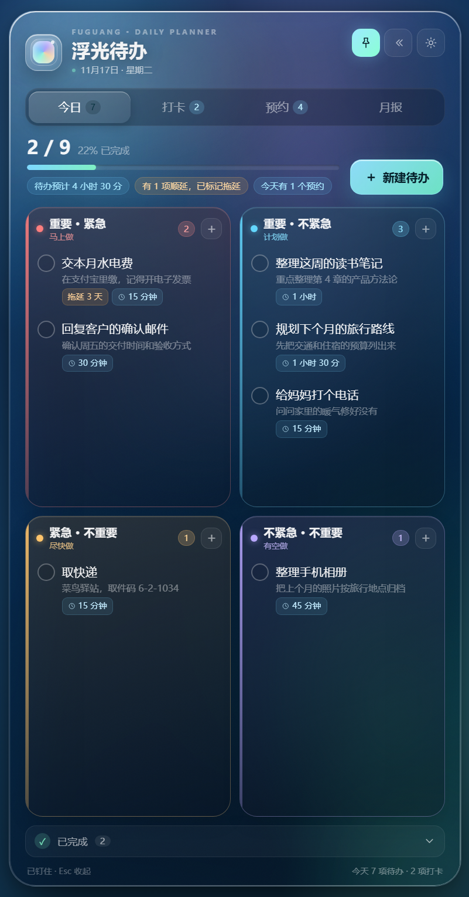
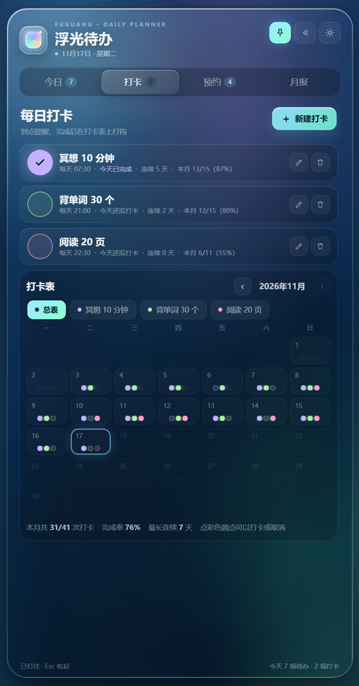
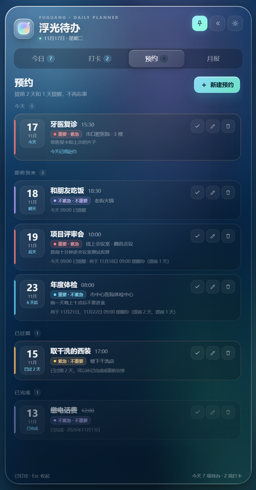
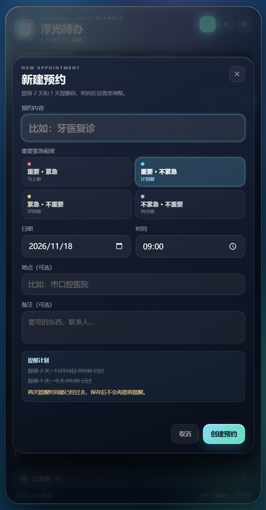
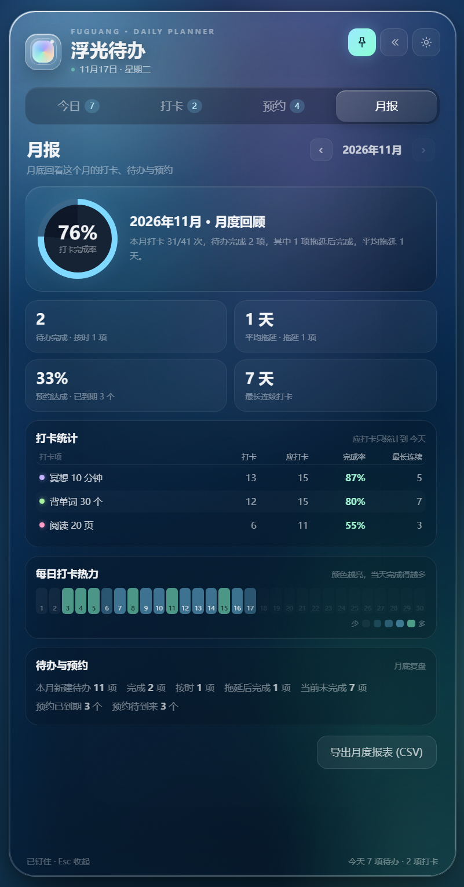
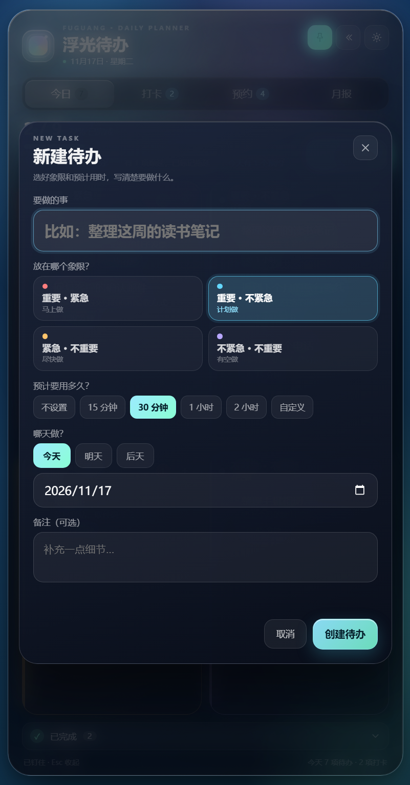

# 浮光待办 · Fuguang Todo

[](https://github.com/Luckwolfwangwang/fuguang-todo/stargazers)
[](LICENSE)
[](https://github.com/Luckwolfwangwang/fuguang-todo/releases)

一个藏在 Windows 桌面左边缘的玻璃待办清单。**回到桌面时**，鼠标移到屏幕左边缘，面板轻轻滑出；移开片刻自动收起，也可以钉在桌面上。在浏览器、Office、聊天软件里碰到边缘不会误触。

> 仓库：<https://github.com/Luckwolfwangwang/fuguang-todo> · 发布版：<https://github.com/Luckwolfwangwang/fuguang-todo/releases>

四象限安排每天、每天固定时间打卡、预约提前提醒、月底看统计报表。



### 不会打扰工作的呼出方式

- 默认只有 **Windows 桌面处于前台** 时，鼠标移到左边缘才会呼出；在其他软件里碰到边缘不会打开。
- 想在工作时打开：点任务栏右下角的**托盘图标**，或双击**桌面快捷方式**（快捷方式会主动打开面板）。
- 如果仍想恢复「任何界面都能悬停呼出」：设置 → **只在桌面悬停呼出** → 关闭即可。

## 功能

### 今日 · 四象限

- **重要 · 紧急**（红）、**重要 · 不紧急**（蓝）、**紧急 · 不重要**（橙）、**不紧急 · 不重要**（紫），颜色和角标一眼分清。
- 每个象限右上角可以单独添加待办；点任务行编辑，点圆圈完成。
- 新建/编辑时可以选**预计用时**（15 分钟 / 30 分钟 / 1 小时 / 2 小时 / 自定义），任务上会显示，今日顶部会汇总剩余待办的总预计用时。
- 当天没完成的待办，第二天会自动顺延到「今日」，并标注 **拖延 N 天**；完成时会记录拖延天数，进入月报统计。
- 顶部进度条、顺延数量、预计用时、今日预约提示；「已完成」可展开回看，点击还能撤销完成。

### 打卡 · 每日习惯

- 每个打卡项可以设置**每天同一个时间提醒**，比如「背单词 30 个」每天 21:00。
- 到点会发系统通知；当天已打卡就不打扰，同一天只提醒一次。
- 打卡表按月查看：完成就打钩，没完成就留空，补卡时点过去的日子即可；漏掉的日子不会自动变成已完成。
- 「总表」用彩色圆点一屏看完全部打卡项，也可以切换到单个打卡项看大号日历。
- 打卡项卡片显示今天是否完成、连续天数、本月完成率。



### 预约 · 提前提醒

- 独立的预约表单：内容、重要紧急程度、日期、时间、地点、备注。
- 预约可以标注四象限（重要紧急 / 重要不紧急 / 紧急不重要 / 不紧急不重要），列表用彩色标签和左侧色条显示，系统提醒也会带上重要程度。
- 在预约日到来的**前 2 天和前 1 天**提醒你（默认每天 09:00 检查，可在设置里改）。
- 列表分「今天 / 即将到来 / 已过期 / 已完成」，显示倒计时、地点和提醒计划。
- 已完成的预约不再提醒；提醒时间已过的条目会如实显示「今天 09:00 已提醒」。





### 月报 · 月底汇报

- 本月打卡完成率、打卡天数、应打卡天数、最长连续天数。
- 待办完成、按时完成、拖延后完成、平均拖延天数、当前未完成。
- 预约已到期 / 已完成 / 待到来，以及预约达成率。
- 每日打卡热力图，一眼看出哪几天断档。
- 一键导出 CSV 统计表，方便留档或自己再做分析。



### 创建待办 · 大字、简洁

- 大字号输入、四象限选择卡片、预计用时快捷芯片、今天/明天/后天快捷日期、备注。
- 默认选中「重要 · 不紧急」和「30 分钟」，鼓励先安排重要的事，也顺手估个时长。
- 编辑时保持同一套表单，删除前会二次确认。



## 安装 / 运行

要求：Windows 10 / 11。

### 直接使用（推荐）

1. 从 [GitHub Releases](https://github.com/Luckwolfwangwang/fuguang-todo/releases) 下载 `fuguang-todo-portable-1.2.0-win-x64.zip`，解压后保留 `resources` 和 `assets` 等所有文件，不能只复制 exe。
2. 双击 `FuguangTodo.exe` 或桌面快捷方式；快捷方式会直接打开面板。
3. 回到桌面后，鼠标移到屏幕左边缘（垂直中间约 400px 范围）即可呼出；工作时请用托盘图标打开。
4. 可以在开始菜单搜索 exe，右键「发送到 → 桌面快捷方式」。

> 未签名的 exe 可能触发 SmartScreen：点「更多信息」→「仍要运行」。

### 从源码运行

需要 Node.js 20+。

```powershell
cd fuguang-todo
npm install
npm start
```

### 打包便携版

```powershell
npm run package
```

输出在 `release/浮光待办-win32-x64/`。

### 测试

```powershell
npm test
```

覆盖日期工具、任务顺延、打卡统计、预约提醒去重、月报和 CSV 导出。

## 操作速查

| 操作 | 效果 |
| --- | --- |
| 回到桌面，鼠标移到左边缘 | 呼出面板 |
| 在其他软件里碰到左边缘 | 不会呼出（默认只在桌面生效） |
| 点托盘图标 / 双击桌面快捷方式 | 在任何界面主动打开面板 |
| 鼠标移开约 1.1 秒 | 自动收起（未钉住时） |
| 点右上角图钉 | 钉住，不再自动收起 |
| `Esc` | 关闭弹窗 / 收起面板 |
| `N` 或 `Ctrl+N` | 新建待办 |
| 点任务圆圈 | 完成 / 撤销完成 |
| 点任务文字 | 编辑、改日期、改象限、删除 |
| 点打卡圆圈 | 完成今天的打卡 |
| 点打卡表格子 | 打卡 / 补卡 / 取消 |
| 托盘图标 | 打开、新建、打卡、预约、月报、设置、退出 |

## 提醒规则

- **打卡**：每天到设定时间，如果当天还没打卡且应用在运行，发系统通知。同一天只提醒一次；如果当天稍后才启动应用，会补发一次。
- **预约**：预约日前 2 天和前 1 天，在设定的提醒时间检查；已完成、已过期或当天已经提醒过的不会重复。应用当天没运行的话，当天再次打开时会补发。
- **待办**：日期早于今天的未完成项会自动顺延到今天，并显示「拖延 N 天」。手动修改日期会重置拖延计数，视为重新安排。
- **打卡漏掉**：按需求在打卡表上留空，不自动补成完成；支持点过去的日子手动补卡。

## 数据与隐私

- 数据只保存在本机：`%APPDATA%\FuguangTodo\data.json`。
- 每日自动备份到同目录的 `backups\`，最多保留 60 份。
- 设置里可以「打开数据文件夹」直接查看或拷贝备份。
- 不联网、不上传任何内容。
- 玻璃背景只在本机截取桌面当前区域做模糊，不保存、不上传；截取时面板处于收起状态。

## 项目结构

```
src/
  main.js                 Electron 主进程：左边缘透明窗口、悬停唤出、托盘、通知调度、IPC
  desktop-watch.cs        前台窗口检测助手源码（只在桌面时允许悬停）
  desktop-watch.exe       编译后的前台窗口检测助手
  preload.js              contextBridge 暴露的最小 API
  store.js                数据模型：任务、顺延、打卡、预约、月报、CSV
  dates.js                本地日期工具（避免时区偏移）
  renderer/
    index.html            面板结构
    styles.css            玻璃质感、四象限配色、表单、日历、月报
    renderer.js           四个分页、创建表单、打卡表、预约、月报
scripts/
  capture.js              开发用：驱动应用生成 docs 截图
  demo.js                 开发用：演示数据
tools/make-icon.py        生成应用图标
test/                     日期与数据逻辑测试
assets/                   应用图标
docs/                     截图
```

## 已知限制

- 面板固定在**主显示器**左侧；多显示器时，另一块屏幕的左边缘不会触发。
- 桌面检测依赖 Windows 前台窗口；如果检测助手无法运行，会自动回退为原来的「任意位置悬停」，并在日志里记录。
- 全屏游戏 / 全屏视频可能盖住置顶面板，这是 Windows 全屏优化的行为。
- 系统提醒依赖应用正在运行；应用完全关闭时不会弹通知，但当天再打开会补发当天应发的提醒。
- 便携版移动文件夹后，之前设置的「开机自动启动」需要重新开关一次。
- 第一次启动需要允许 Electron 的透明窗口；如果看不到玻璃条，按 `Win+D` 回到桌面，或从托盘菜单打开。

## 更新记录

更新记录见 [CHANGELOG.md](CHANGELOG.md)。

## 作者

**Luckwolfwangwangzbs** · [GitHub @Luckwolfwangwang](https://github.com/Luckwolfwangwang)

这个项目覆盖了 Electron 透明窗口、桌面左边缘悬停、四象限任务、每日打卡、预约提醒和本地数据统计。如果它对你的桌面有帮助，欢迎点一个 ⭐ Star，这是对我继续维护最大的鼓励。

## License

MIT. See [LICENSE](LICENSE).

---

**English**: Fuguang Todo is a glass daily planner for Windows that hides at the left edge of the desktop. Hover the edge **while the desktop is in front** to reveal four Eisenhower quadrants, daily habit check-ins with per-habit reminder times and a monthly check-in sheet, and appointments reminded 2 days and 1 day ahead. Other apps never trigger the panel by accident; the tray icon and desktop shortcut open it explicitly. Unfinished tasks roll over with a delay badge; monthly reports and CSV export are built in. Local-only JSON storage with daily backups, no network.
